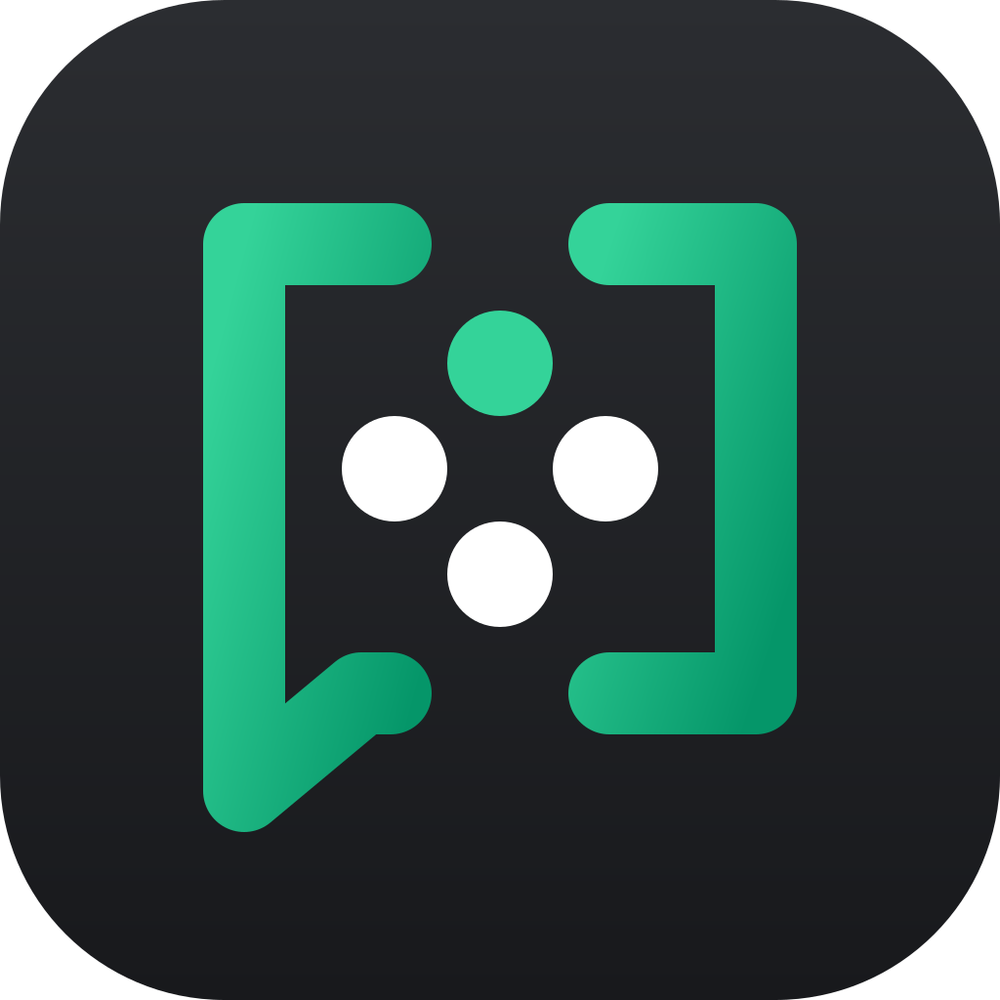

<p align="center">
  
</p>

<p align="center">
  <a href="https://github.com/Duell10111/NexSpeak/actions/workflows/ci.yml"></a>
  <a href="https://github.com/Duell10111/NexSpeak/releases/latest"></a>
  <a href="https://github.com/Duell10111/NexSpeak/actions/workflows/release-please.yml"></a>
  <a href="LICENSE"></a>
  <a href="https://matrix.org"></a>
  
  
  <a href="https://github.com/Duell10111/NexSpeak/issues"></a>
</p>

# NexSpeak

A Discord-like client for [Matrix](https://matrix.org): spaces are shown as servers, rooms as channels, plus
direct messages, voice/video calls and screen sharing. Available as a web app and a desktop app (Electron).

**User documentation:** [nexspeak.readthedocs.io](https://nexspeak.readthedocs.io) – getting started, installing,
calls, settings, encryption and [nightly builds](https://nexspeak.readthedocs.io/en/latest/nightly.html).

- **Chat:** replies, threads, reactions, editing, deletion, pinned messages, Markdown (Discord flavoured,
  sent as `formatted_body` and rendered sanitized), mentions with autocompletion (@person, #channel, @room),
  typing indicator, files (also via drag & drop/paste), read receipts, invites
- **Safety:** ignore people, report messages and channels to the homeserver admins
- **End-to-end encryption:** messages and attachments, recovery key with key backup, device verification
  by emoji comparison (compatible with Element)
- **Calls:** MatrixRTC with LiveKit, compatible with Element Call; in encrypted rooms the media is end-to-end
  encrypted as well. Works like Discord: tile view with speaking indicator, focus on a camera or screen share,
  per-person volume (right click), chat next to the call, mute even before joining, screen sharing with
  selectable resolution (up to source) and frame rate (up to 60 FPS), adjustable while streaming
- **Push to talk:** key or mouse button with release delay; system-wide in the desktop app (also in games)
- **Notifications:** for new messages according to the Matrix push rules (same settings as Element), unread
  count in the window title and as app badge; per channel or whole server: all messages, mentions only or muted
- **Profile:** display name, avatar and status (online, away, invisible)
- **Mobile layout:** navigation and member list as slide-in panels
- **Login:** password, SSO, or native OIDC including sign-up on homeservers with next-generation auth (Matrix
  Authentication Service, e.g. matrix.org); the desktop app uses the SSO compatibility layer there
- **About:** version, source of the running build, open source licenses (generated at build time); no tracking
- **Links:** matrix.to links to rooms, servers and people open in the app; the desktop app handles
  `nexspeak://` links
- **UI languages:** German and English

## Structure

| Folder | Contents |
|---|---|
| `apps/web` | Next.js web app (UI, E2E tests) |
| `apps/desktop` | Desktop app with Electron, packages the web build ([README](apps/desktop/README.md)) |
| `apps/mobile` | Mobile app with Expo (planned) |
| `packages/core` | Matrix and call logic without UI |
| `packages/i18n` | UI texts (German, English) |
| `dev` | Local homeserver with calls (Docker) |
| `docs` | User documentation (Sphinx, published on Read the Docs) and planning |

All commands are run in the repository root.

## Requirements

- Node.js 24 (LTS), see `.nvmrc` → `nvm use`
- A Matrix homeserver. For **calls** it has to offer a MatrixRTC service (LiveKit SFU +
  [lk-jwt-service](https://github.com/element-hq/lk-jwt-service)) – the same one Element Call uses. NexSpeak
  looks for it in this order:
  1. `GET /_matrix/client/unstable/org.matrix.msc4143/rtc/transports` (Synapse: `matrix_rtc.transports`)
  2. `org.matrix.msc4143.rtc_foci` in `/.well-known/matrix/client`
  3. Environment variable `NEXT_PUBLIC_LIVEKIT_SERVICE_URL` (fallback at build time)

  Homeservers with Element Call (e.g. matrix.org) work without further configuration.

## Development

```bash
nvm use
npm install
npm run dev        # http://localhost:3000
```

### Local homeserver with calls

`dev/docker-compose.yml` starts Synapse, LiveKit and lk-jwt-service, configured for calls:

```bash
docker compose -f dev/docker-compose.yml up -d
```

Then enter `http://localhost:8008` as the homeserver in the app. Accounts can be registered without
confirmation, e.g. with Element or via the API. The stack is meant for development only (fixed secrets,
self-signed TLS).

### Desktop app

```bash
npm run dev           # terminal 1
npm run dev:desktop   # terminal 2: Electron against the dev server
npm run dist:desktop  # installers in apps/desktop/release/
```

Details in [apps/desktop/README.md](apps/desktop/README.md).

## Tests

```bash
npm test                 # unit tests (Vitest)

docker compose -f dev/docker-compose.yml --profile e2e up -d
npm run test:e2e:docker  # end-to-end tests (Playwright) with browsers in a Linux container
npm run test:e2e         # the same tests with locally installed browsers
npm run test:e2e:desktop # desktop app (Electron) with the static export
```

The end-to-end tests register their own users and drive several browsers at once to test chat, encryption,
calls (including E2EE audio), recovery/verification and the mobile layout. By default the browsers run in
the container, because Chromium cannot open a (fake) microphone on some macOS versions.

## Troubleshooting calls

Run `localStorage.setItem("nexspeak:debug", "1")` in the browser console and reload – NexSpeak and LiveKit
then log verbosely. Common causes:

- "Your homeserver doesn't offer voice channels": no MatrixRTC service found (see requirements).
- "You aren't allowed to join calls in this room": members may not join calls in this room. Admins see
  "Allow everyone" in the call (sets the power level for `org.matrix.msc3401.call.member` to 0, like Element).

## Build & deployment

```bash
npm run build   # static export to apps/web/out/
npm start       # serves apps/web/out/ locally with the security headers
```

The app is a purely client-side Matrix application; credentials only go to the homeserver. The export runs
on any static web server – requirements (security headers, MIME types, caching) and examples for Caddy and
nginx are in [docs/hosting.md](docs/hosting.md). The LiveKit E2EE worker is copied to
`apps/web/public/livekit-e2ee-worker.mjs` during the build.

## Contributing & license

Contributions are welcome – see [CONTRIBUTING.md](CONTRIBUTING.md). Before your first merge you sign the
[CLA](CLA.md) once (by commenting on the pull request).

NexSpeak is licensed under the [GNU Affero General Public License v3.0 or later](LICENSE).
